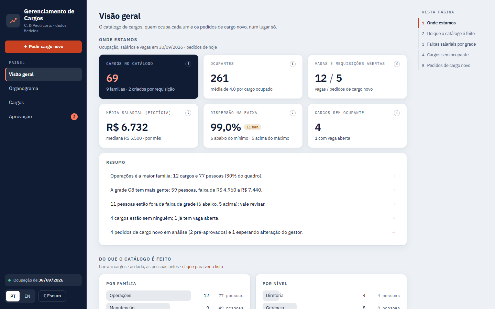
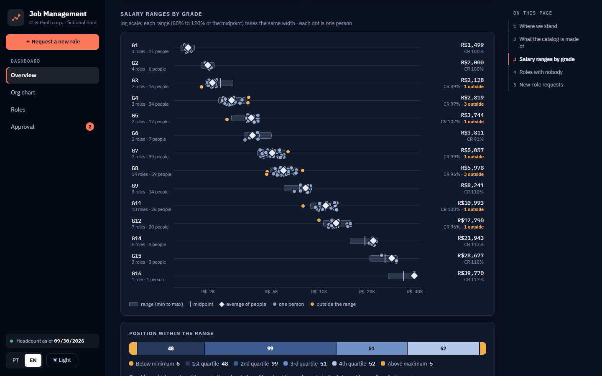
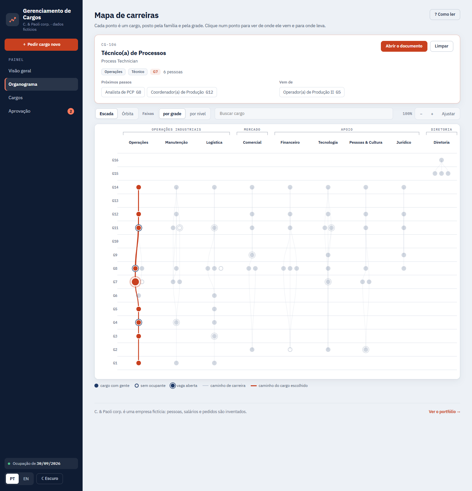
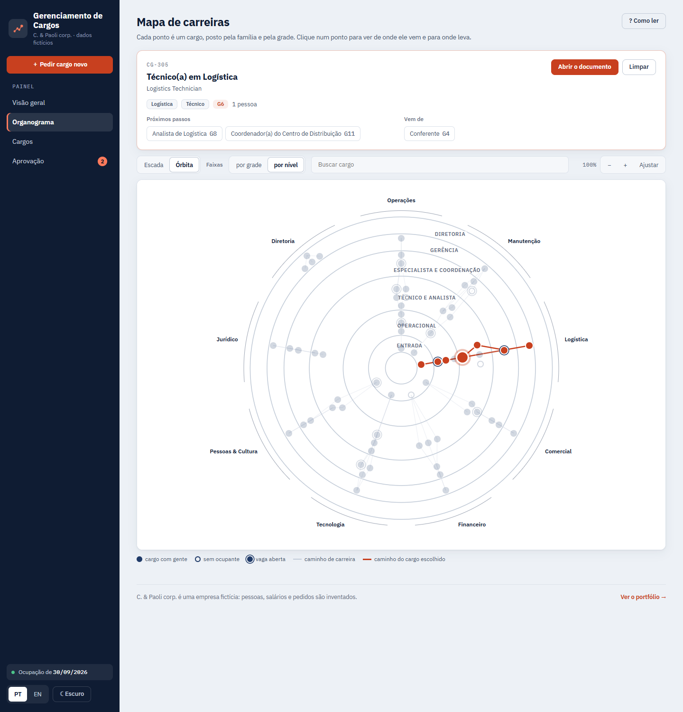
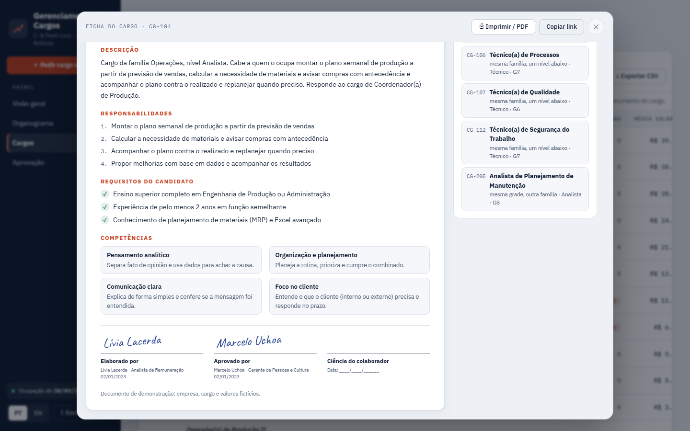
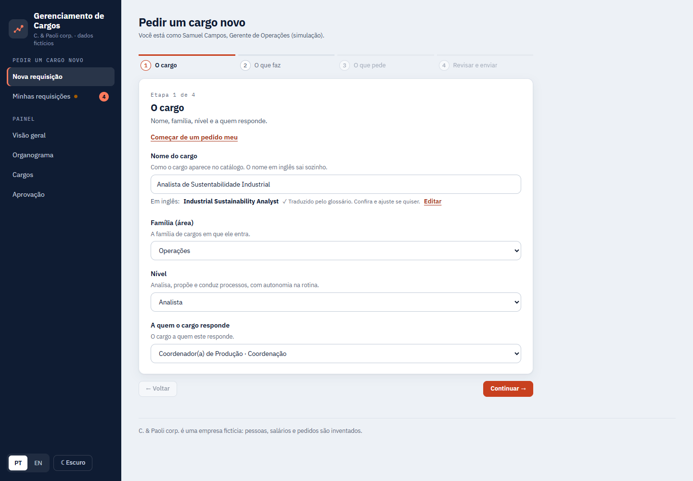
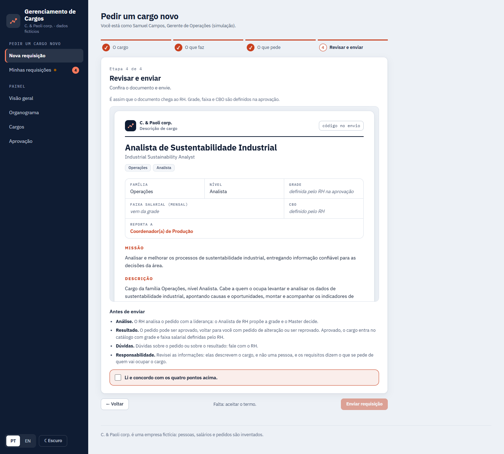
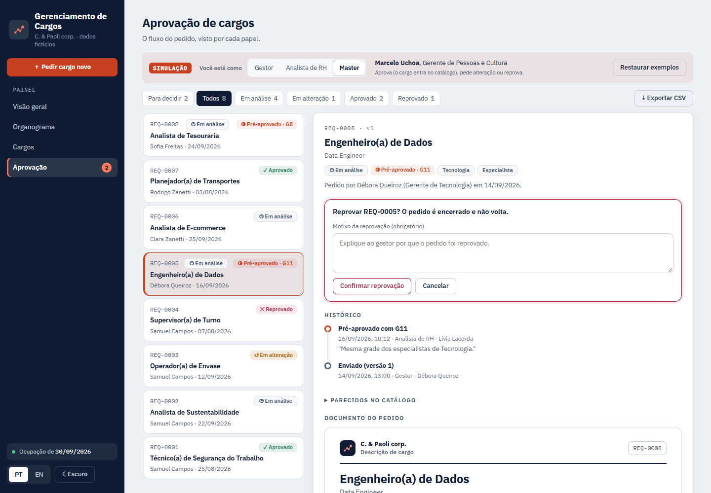
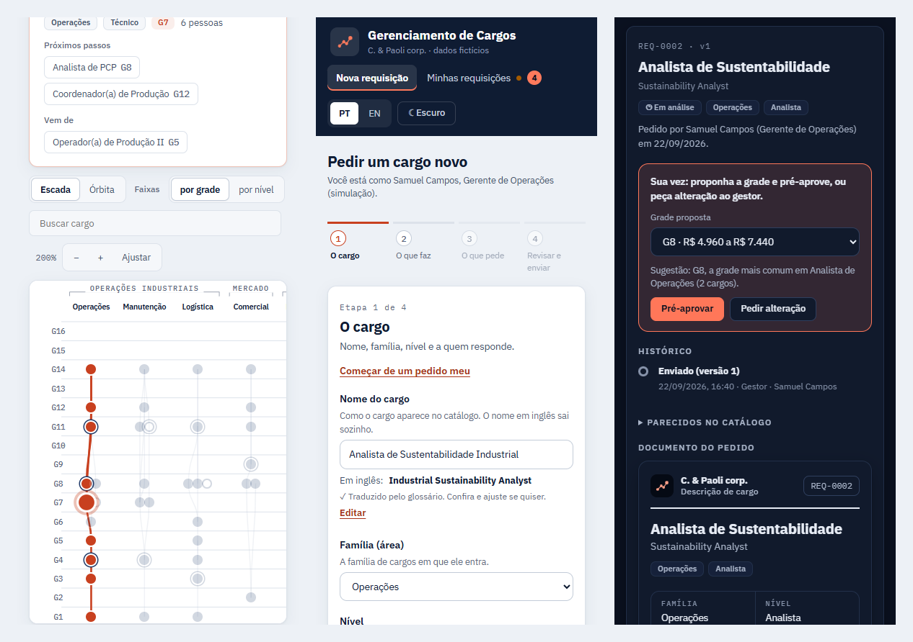
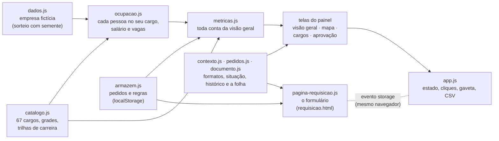

# Gerenciamento de Cargos · C. & Paoli corp.

**Catálogo de cargos, mapa de carreiras, documento de cada cargo, formulário de cargo novo em página própria e fluxo de aprovação.** Dados 100% fictícios, gerados no seu navegador. Português e inglês, tema claro e escuro, sem build e sem biblioteca: HTML, CSS e JavaScript puros, prontos para o GitHub Pages.

[](https://fernandotrecruiter.github.io/gerenciamento-de-cargos/)
[](https://fernandotrecruiter.github.io/)



Inspirado num app de requisição e gestão de cargos que construí no trabalho, reescrito do zero: outro código, outro visual e nenhum dado real. A empresa é a mesma das outras demos do portfólio: a C. & Paoli corp., com Matriz, Fábrica, Centro de Distribuição e Remoto.

## Sumário

1. [Por que existe](#por-que-existe)
2. [As telas](#as-telas)
3. [Regras de negócio](#regras-de-negócio)
4. [Como funciona](#como-funciona)
5. [Rodar e publicar](#rodar-e-publicar)
6. [Plugar um catálogo próprio](#plugar-um-catálogo-próprio)
7. [Testes](#testes)
8. [Limitações](#limitações)
9. [English summary](#english-summary)

## Por que existe

Em muita empresa, cargo é um nome que alguém digitou um dia no sistema de folha. Daí vêm as dores que todo RH conhece:

- **O mesmo trabalho com três nomes** (e três salários). Isso confunde a carreira, atrapalha a pesquisa salarial e cria risco de equiparação salarial (art. 461 da CLT).
- **A descrição de cargo mora num arquivo de texto** que ninguém atualiza, cada uma num formato.
- **O pedido de cargo novo chega por mensagem**: "preciso de um analista de sustentabilidade". O RH passa dias perguntando nível, chefe, requisitos, e o que o cargo faz de diferente dos que já existem.
- **A grade é decidida sem comparação** e sem registro de quem decidiu o quê.
- **Ninguém vê o todo**: quantos cargos existem, quais estão vazios, quem ganha fora da faixa, para onde cada carreira leva.

O app responde a cada uma:

| Pergunta do RH | Onde o app responde |
|---|---|
| "Quantos cargos temos e onde está a gente?" | **Visão geral**: 6 indicadores, cada um com o "i" que mostra a conta e o clique que abre a lista por trás |
| "A faixa salarial está sendo respeitada?" | **Faixas por grade**: a faixa, o ponto médio, a média e cada pessoa como um ponto; quem está fora fica em âmbar |
| "Para onde esta carreira leva?" | **Mapa de carreiras**: cada ponto é um cargo, posto pela família e pela grade; clicar acende o caminho de onde se vem e para onde se vai |
| "O que este cargo faz e o que ele pede?" | **Ficha do cargo**: missão, descrição, responsabilidades, requisitos do candidato, competências, grade, faixa e CBO, com Imprimir / PDF |
| "Preciso de um cargo novo." | **Pedir cargo novo**: página própria, 4 etapas curtas, que escreve o documento no formato do catálogo |
| "Quem aprovou e com que grade?" | **Aprovação**: a fila à esquerda, o pedido à direita; cada decisão pede confirmação e fica no histórico |

## As telas

**Visual próprio, diferente das outras demos do portfólio:** marinho como tinta e moldura, fundo claro e frio e uma cor de destaque só, o coral, para o que é ação ou seleção (os dados usam o marinho). Fonte IBM Plex Sans, números em IBM Plex Mono. A navegação é um **menu lateral** (no celular ele vira a faixa de cima, com o menu rolando de lado). Tema claro e escuro.

### 1. Visão geral

Seis indicadores (cargos no catálogo, ocupantes, vagas e requisições abertas, média salarial, dispersão na faixa e cargos sem ocupante), um resumo em frases, a distribuição por família e por nível, as faixas salariais por grade, a posição de cada pessoa dentro da faixa, os cargos vazios e os pedidos por situação.

Todo número tem um **"i"** com a conta e as partes dela. Quase tudo é clicável: o número, a barra, a linha da grade, o pedaço da barra empilhada. O clique abre **a lista que está por trás**, com busca, ordenação e **Exportar CSV**.



### 2. Mapa de carreiras (aba Organograma)

Cada ponto é um cargo do catálogo. O mesmo dado em duas vistas:

- **Escada:** cada coluna é uma família; quanto mais alto o ponto, maior a grade. Na base ficam os cargos de entrada. Uma chave fina sobre as colunas junta as famílias de cada diretoria.
- **Órbita:** os cargos de entrada ficam no centro e a grade cresce para fora; cada fatia é uma família, com o nome por fora do arco.

**Faixas** troca as listras do fundo: uma por grade (G1 a G16) ou uma por nível (Entrada, Operacional, Técnico e analista, Especialista e coordenação, Gerência, Diretoria), com o nome do nível como marca-d'água. As linhas são as **trilhas de carreira** dentro da família. **Clicar num ponto** acende o caminho inteiro (de onde se vem e para onde se vai) e abre o resumo do cargo logo abaixo do título, com os próximos passos e o **Abrir o documento**. Tem busca (marca os achados; Enter escolhe o primeiro) e zoom (o mapa cresce dentro da caixa, o ponto não engorda; arrastar move).

Ponto cheio é cargo com gente; vazado, sem ocupante; com anel, vaga aberta. O caminho do cargo escolhido fica em coral.

**Movimento, para ler melhor:** trocar Escada e Órbita faz os **pontos deslizarem** até o lugar novo (as linhas e os nomes voltam esmaecendo); ao escolher um cargo, **o caminho se desenha a partir dele**, passo a passo; o resumo do cargo entra deslizando; passar o mouse num ponto acende os vizinhos diretos; o zoom é suave e o arraste ainda desliza um pouco ao soltar. Quem pediu "reduzir movimento" ao sistema vê tudo parado, e `?foto=1` também desliga o movimento (é assim que as fotos desta página são tiradas).





### 3. Cargos e a ficha de cada um

A tabela tem busca, filtros (família, nível, grade, só sem ocupante, só com vaga) e ordenação em qualquer coluna. Cada linha abre a **ficha**: o documento do cargo à esquerda e, ao lado, a ocupação (pessoas, média salarial, compa-ratio, vagas) e os **cargos parecidos**, cada um com o porquê ("mesma família e nível", "nome parecido"...). A janela do documento rola por dentro (a página de trás fica parada) e avisa quando há mais conteúdo embaixo. No fim, as **assinaturas** (fictícias): elaborado por, aprovado por e a ciência do colaborador. **Imprimir / PDF** sai só a folha, em papel branco, com as assinaturas.



### 4. Pedir cargo novo (página própria)

O botão **＋ Pedir cargo novo**, no topo do menu lateral, abre o formulário em outra página (`requisicao.html`), pensada para quem pede: pouca coisa na tela de cada vez, ajuda curta embaixo de cada rótulo e quatro etapas que não dá para pular.

1. **O cargo:** nome (o inglês sai sozinho, do catálogo ou de um glossário; palavra desconhecida ele pergunta), família, nível e a quem responde (já vem sugerido).
2. **O que faz:** missão e responsabilidades. A descrição sai pronta delas; quem preferir escreve a sua. **Preencher para mim** monta um rascunho por modelo de frases (sem IA) e só preenche o que está vazio.
3. **O que pede:** escolaridade, experiência e competências já chegam com o padrão do nível. Idioma, viagens, turnos e habilitação ficam em **Mais requisitos**, fechado. Embaixo, ao vivo, a lista de requisitos que vai para o documento.
4. **Revisar e enviar:** o documento do jeito que o RH vai receber, o termo em 4 pontos e o envio.

Na aba **Minhas requisições**, cada pedido mostra a situação, o recado do RH, o histórico e o documento. Pedido devolvido tem **Editar e reenviar** (vira a versão 2 do mesmo pedido).





### 5. Aprovação (simulação)

Uma faixa no topo avisa que é simulação e troca quem você é: **Gestor**, **Analista de RH** ou **Master**. À esquerda, a fila: cada pedido com a situação, quem pediu e quando, com filtros por situação e **Exportar CSV**. À direita, o pedido aberto: o que cabe ao seu papel agora, o histórico em linha do tempo, os cargos parecidos do catálogo e o documento.

Nenhuma decisão vale com um clique só: **Pré-aprovar**, **Aprovar**, **Pedir alteração** e **Reprovar** abrem uma confirmação que diz o que vai acontecer e pede o texto quando ele é obrigatório: o comentário de **Pedir alteração** e o motivo de **Reprovar**, escrito livre (não há lista de motivos).



### 6. No celular



## Regras de negócio

Vieram do app de trabalho e foram reescritas aqui:

1. **Requisito pede do candidato; nunca descreve o cargo.** Cada campo tem dois textos: o rótulo da tela ("Viagens: frequentes") e a frase que vira requisito ("Disponibilidade para viagens frequentes"). Requisito escrito à mão que começa com "O cargo..." ganha um aviso. O teste confere que nenhum requisito do catálogo começa assim.
2. **Situação do pedido:** Em análise, Em alteração, Aprovado ou Reprovado. A pré-aprovação é uma etapa dentro de "Em análise": o gestor continua vendo "Em análise"; o RH vê "Pré-aprovado · G9".
3. **Papéis:** o Gestor pede e reenvia; o Analista de RH pré-aprova com a grade ou pede alteração; o Master aprova (o cargo entra no catálogo), pede alteração ou reprova. Pedir alteração exige comentário; reprovar exige o motivo, escrito livre (sem lista de motivos), e o gestor lê esse texto. As regras moram num lugar só (`js/armazem.js`).
4. **Nenhuma decisão com um clique só:** toda decisão passa por uma confirmação que diz o que vai acontecer.
5. **Modelo = só pedidos da própria pessoa.** "Começar de um pedido meu" lista apenas os seus pedidos, nunca o de outro gestor; o conteúdo vira um pedido novo.
6. **Descrição igual, título diferente:** se a descrição for igual (sem contar acento, maiúscula e espaço) à de outro pedido seu com outro título, aparece um aviso. Não trava o envio. Pedido reprovado não conta.
7. **Pedido repetido e cargo que já existe:** mesmo título de um pedido seu em aberto, ou de um cargo do catálogo, também gera aviso, com o link para conferir.
8. **Termo de envio em 4 pontos:** Análise, Resultado, Dúvidas e Responsabilidade. O botão de enviar só liga com tudo preenchido e o termo aceito.
9. **Nível e grade:** o nível define o mínimo de escolaridade (opções abaixo do mínimo ficam desligadas); a grade é do RH. A sugestão de grade é a mais comum entre os cargos da mesma família e nível, e a tela diz o porquê.
10. **Faixa por grade:** cada grade tem mínimo, ponto médio e máximo (80% a 120% do ponto médio). **Compa-ratio** = salário ÷ ponto médio.
11. **Aprendiz e estagiário** não escolhem escolaridade: os requisitos vêm da lei e do contrato.

## Como funciona



O painel (`index.html`) e o formulário (`requisicao.html`) são duas páginas que leem os mesmos arquivos e guardam os pedidos no mesmo lugar do navegador (`localStorage`). Quando uma página grava, o navegador avisa a outra (evento `storage`) e ela se redesenha: o pedido enviado no formulário aparece na fila da Aprovação, e a decisão tomada no painel aparece em Minhas requisições.

| Arquivo | O que faz |
|---|---|
| `index.html` | O painel: visão geral, mapa de carreiras, cargos e aprovação |
| `requisicao.html` | A página do formulário de cargo novo e de Minhas requisições |
| `js/dados.js` | A empresa fictícia (a mesma da demo de People Analytics): ~260 pessoas ativas com área, nível, unidade e admissão |
| `js/catalogo.js` | Grades, níveis, opções dos campos, competências, os 67 cargos com missão, responsabilidades e requisitos, e as trilhas de carreira do mapa |
| `js/ocupacao.js` | Reparte as pessoas pelos cargos, sorteia o salário dentro da faixa e liga as vagas abertas aos cargos |
| `js/armazem.js` | Os pedidos de cargo novo, os 8 exemplos, as regras do fluxo e o aviso entre as páginas |
| `js/metricas.js` | Toda conta da visão geral (o "i" lê o mesmo objeto do cartão) |
| `js/traducao.js` | Nome do cargo em inglês: par do catálogo, depois glossário |
| `js/redator.js` | "Preencher para mim" e o parágrafo da descrição |
| `js/contexto.js` | O que as duas páginas usam igual: o menu lateral, formatos de data e dinheiro, chip de situação, texto nos dois idiomas, avisos, CSV |
| `js/pedidos.js` | Um pedido na tela: título, documento, linha do tempo e o recado de cada situação |
| `js/documento.js` | O documento do cargo e a janela da ficha |
| `js/graficos.js` | Barras atrás do rótulo, faixas por grade e barra empilhada, em HTML e CSS |
| `js/tela-*.js` | Uma tela do painel por arquivo |
| `js/pagina-requisicao.js` | O formulário em 4 etapas e Minhas requisições |
| `js/i18n.js` | Todo texto da tela em PT e EN |
| `js/app.js` | Estado do painel, cabeçalho, abas, gaveta, CSV e cliques |
| `css/app.css`, `css/documento.css`, `css/requisicao.css` | Identidade, a folha do documento (com o modo impressão) e a página do formulário |

## Rodar e publicar

**Ver no computador:** abra o `index.html` no navegador. Só isso.

Parâmetros de endereço do painel: `?aba=geral|organograma|cargos|aprovacao` · `lang=en` · `tema=escuro` · `papel=gestor|analista|master` · `cargo=CG-104` (abre a ficha) · `req=REQ-0005` (abre o pedido na Aprovação). Do formulário: `requisicao.html?ver=minhas` (Minhas requisições) · `requisicao.html?editar=REQ-0003` (edita um pedido devolvido) · `lang` e `tema` iguais. Nas duas páginas, `foto=1` desliga o movimento.

**Publicar no GitHub Pages:** suba a pasta, vá em **Settings > Pages > Deploy from a branch**, escolha `main` e `/ (root)`. Em 1 ou 2 minutos fica em `https://SEU-USUARIO.github.io/NOME-DO-REPOSITORIO/`.

Os pedidos ficam no `localStorage` do navegador de quem usa: cada visitante tem a sua simulação. **Restaurar exemplos**, na aba Aprovação, volta aos 8 pedidos iniciais.

## Plugar um catálogo próprio

O app separa **o que é catálogo** (`js/catalogo.js`), **quem ocupa** (`js/ocupacao.js`) e **o que é pedido** (`js/armazem.js`). Para usar com o seu:

**1. A tabela salarial** (`GRADES`): mínimo, ponto médio e máximo por grade, em reais por mês.

```js
GRADES[8] = { grade: 8, min: 4960, med: 6200, max: 7440 };
```

**2. Os cargos** (`CARGOS`): os requisitos usam os mesmos campos do formulário, então o documento sai igual para cargo antigo e cargo novo.

```js
{
  codigo: 'CG-104', area: 'ops', nivel: 'ana', grade: 8,
  nome: ['Analista de PCP', 'Production Planning Analyst'],     // [português, inglês]
  reportaA: 'CG-102',                                            // código do cargo chefe (null no topo)
  cbo: '3911-25',                                                // exibido como "exemplo"
  missao: ['Planejar e controlar a produção...', 'Plan and control production...'],
  resp: [['Montar o plano semanal...', 'Build the weekly plan...'], ...],
  req: { esc: 'superior', form: ['Engenharia de Produção', 'Production Engineering'], exp: 2,
         idi: [['ingles', 'intermediario']], via: 1, tur: false, cnh: null,
         extra: [['Excel avançado', 'Advanced Excel']] },
  comp: ['analitico', 'organizacao', 'comunicacao'],             // chaves de COMPETENCIAS
  criadoEm: '2023-01-02'
}
```

`area` e `nivel` são as chaves de `DADOS.areas` e `DADOS.niveis` (troque também em `js/dados.js` se as suas famílias forem outras). `esc` aceita `fund`, `medio`, `tecnico`, `superior`, `pos`, `apr` (aprendiz) e `est` (estágio); `via` vai de 0 (não viaja) a 3 (constantes).

**3. As trilhas de carreira** (`TRILHAS`): pares `[de, para]`, um passo de carreira cada. O mapa desenha uma linha por par e, ao clicar num cargo, segue os pares para cima e para baixo. `GRUPOS` junta as famílias sob a chave de cada diretoria e `FAIXAS_NIVEL` dá o nome de cada degrau.

```js
['CG-106', 'CG-104'],   // de Técnico(a) de Processos dá para ir a Analista de PCP
```

**4. Os ocupantes:** com dado real, troque o sorteio de `js/ocupacao.js` por uma lista no mesmo formato e mantenha a função `resumo(codigo)`:

```js
{ id: 'C0042', nome: '...', cargo: 'CG-104', area: 'ops', nivel: 'ana', grade: 8,
  unidade: 'fab', admissao: new Date('2022-03-14'), salario: 6100,
  cr: 6100 / 6200, pos: (6100 - 4960) / (7440 - 4960), faixaPos: 'q3' }
```

**5. Os pedidos:** para valer de verdade, o `localStorage` dá lugar a um servidor com login. As funções do `armazem.js` (`criar`, `preAprovar`, `aprovar`, `devolver`, `reprovar`, `reenviar`) viram chamadas a uma API, o aviso entre as páginas vira uma consulta ao servidor, e o papel passa a vir do login, nunca de um seletor na tela.

> Salário individual é dado sensível. Aqui ele é fictício e aparece para demonstrar as contas; num sistema real, a lista de pessoas com salário só aparece para quem tem esse papel.

## Testes

Um navegador de verdade (Edge ou Chrome sem tela, pelo protocolo do DevTools) percorre o painel e a página do formulário e confere 29 coisas:

- sem erro de JavaScript nas 4 abas e na página do formulário (as 4 etapas e Minhas requisições) em PT/EN e claro/escuro, sem chave de texto faltando e sem travessão;
- **idioma sem mistura:** com a tela em inglês, nenhuma palavra nem acento de português; com a tela em português, nenhum rótulo em inglês. Fica de fora o que é nome de pessoa e o nome do cargo na outra língua, que aparece de propósito e vai marcado com `lang=` (o leitor de tela pronuncia certo e o teste sabe que é intencional). Os 8 pedidos de exemplo vêm escritos nas duas línguas;
- os 6 números da visão geral batem com uma conta feita do zero a partir do catálogo, e todo colaborador ativo tem um cargo;
- o "i" abre a conta; o clique no número abre a lista com o mesmo total; o CSV sai com as mesmas linhas;
- a ficha abre pelo mapa e pela tabela, com as 5 seções; com ela aberta, a roda do mouse não mexe a página de trás e o documento rola por dentro até as assinaturas;
- o mapa tem um ponto por cargo e uma linha por trilha; na Escada, mesma grade é mesma altura e cada família é uma coluna; na Órbita, mesma grade é o mesmo anel e grade maior fica mais longe do centro;
- clicar num ponto acende exatamente o caminho calculado a partir das trilhas e abre o detalhe logo abaixo do título; as faixas mostram os 6 níveis ou as 16 grades; a busca marca e conta os achados sem perder o foco; o zoom aumenta o quadro sem engordar o ponto e Ajustar volta;
- o movimento existe e para quando deve: na troca de Escada para Órbita os pontos são os mesmos e deslizam; o caminho se desenha a partir do escolhido; o resumo entra com transição; o mouse acende exatamente os vizinhos diretos; com `?foto=1` nada anima;
- a busca da tabela não perde o foco; o CSV da tabela traz todas as linhas;
- nenhum requisito descreve o cargo; o modelo só lista pedidos da própria pessoa e vira um pedido novo;
- o aviso de descrição igual aparece, não trava o envio, some quando a descrição muda e ignora pedido reprovado;
- o botão "Pedir cargo novo" abre a página; o pedido enviado aparece em Minhas requisições; no painel, pré-aprovar e aprovar pedem confirmação, o Analista pré-aprova (G9), o Master aprova e o cargo entra no catálogo; o gestor vê Aprovado na página;
- pedir alteração exige comentário e o gestor reenvia pela página (versão 2); reprovar exige o motivo escrito (sem lista) e o gestor lê esse motivo; Cancelar não muda nada;
- um pedido gravado por outra aba aparece na fila e no selo da aba sem recarregar;
- imprimir mostra só a folha, em branco, com as assinaturas;
- no celular (390 px) nada vaza para o lado, no painel e no formulário.

```bash
pip install websocket-client
python tests/teste_cargos.py
```

Termina com `RESULTADO: TUDO OK` (ou o número de falhas e código de saída 1), em cerca de 3 minutos. Cada checagem começa dos dados de fábrica; se a ligação com o navegador cair no meio (acontece com a máquina carregada), a bateria abre o navegador de novo e repete aquela checagem uma vez antes de reprovar.

Para provar que o teste mede o que diz medir, catorze regras foram estragadas de propósito, uma por vez, numa cópia do repositório: aviso de descrição igual contando pedido reprovado, modelo com pedidos de outros, número do cartão, caminho do mapa só para cima, altura errada na Escada, ponto que engorda no zoom, pontos que pulam em vez de deslizar, texto em português na tela em inglês, pedido de alteração sem comentário, pular etapa, sem aviso entre as páginas, decisão sem confirmação, vazamento no celular e impressão com a coluna do lado. Em todas, caiu a checagem daquela regra (e só ela), e a cópia sem estrago passou. A repetição depois de uma queda também foi ensaiada fechando de verdade a ligação com o navegador no meio de uma checagem: a bateria avisou, abriu o navegador de novo e terminou com TUDO OK.

## Limitações

- **Sem servidor e sem login:** os pedidos ficam no navegador de quem usa e os papéis são escolhidos num seletor. É uma simulação, e a tela diz isso.
- **Painel e formulário conversam só no mesmo navegador:** o aviso entre as páginas é do próprio navegador; outra pessoa, em outro computador, não vê os seus pedidos.
- **O mapa mostra as trilhas que o catálogo declara:** ele não inventa carreira. Cargo sem trilha aparece como ponto solto.
- **CBO de exemplo:** os códigos são ilustrativos e aparecem marcados como "exemplo". Confira na tabela oficial da CBO antes de usar.
- **Tradução por glossário:** cobre os títulos comuns de cargo; palavra fora do glossário pede o inglês à pessoa, em vez de chutar.
- **"Preencher para mim" é modelo de frases**, não IA: dá um rascunho coerente com o nível, que a pessoa deve revisar.
- **Conteúdo do pedido fica no idioma em que foi escrito:** sem tradução automática, o texto de quem pede aparece como foi escrito; na tela na outra língua, o documento avisa e marca o trecho com `lang=`. Os 8 pedidos de exemplo vêm nas duas línguas.
- **Fontes do Google:** sem internet, a demo abre na fonte do sistema.

## Licença

MIT. Feito por [Fernando Paoli](https://github.com/FernandoTRecruiter), com o Claude Code como dupla.

---

## English summary

**Job Management** is a demo of a job catalog app with fictional data, with its own look (deep navy, a single coral accent, IBM Plex type, a side menu that becomes a top bar on phones): an overview dashboard (roles, people, open vacancies and requests, average pay, spread within the salary range, empty roles), a **career map** where each dot is a role (Ladder view: one column per job family, height = grade; Orbit view: entry roles at the center, grade grows outward; click a dot and its career path draws itself; switching views slides the dots to their new place), a searchable job catalog where each role has a printable job description, a **separate request page** with 4 short steps, and a simulated approval flow (Manager requests, HR Analyst pre-approves with a grade, Master approves and the role joins the catalog) where every decision asks for confirmation and lands in a timeline. The dashboard and the request page talk through the browser's `localStorage`.

It is my own rewrite, from scratch, of an HR app I built at work: same ideas and business rules (requirements describe the candidate, never the role; templates only from your own requests; a non-blocking warning when a description repeats another request of yours under a different title; 4-point submission terms; "Fill in for me" from sentence templates, no AI; PT/EN job titles), different code and look, zero real data.

Plain HTML, CSS and JavaScript, no build step, no libraries; PT/EN and light/dark. Open `index.html` to run it. The test battery (`python tests/teste_cargos.py`, needs Edge or Chrome) drives a real headless browser through 29 checks, including "no Portuguese on the English screen and no English labels on the Portuguese one", from "the overview numbers match a from-scratch count" to "nothing overflows on a 390 px phone"; if the browser connection drops, it reopens the browser and retries that check once.
